# Ghostcontrol

<p align="center">
  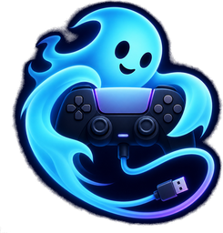
  &nbsp;&nbsp;
  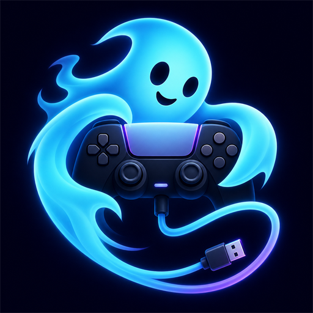
</p>

**Ghostcontrol** lets you use third-party USB and Bluetooth controllers on a jailbroken PS5. A resident controller service owns the hardware; a native home-screen app — **Ghostcontrol Toolbox** — is the GUI. Nothing here patches ShellUI, decrypts system bundles, or depends on firmware offset tables.

| | |
|---|---|
| Current beta | **2.2.2** — native Toolbox title (PPSA62838 lineage) |
| Layout | `core/` service · `ui/` homebrew app · `GhosttoothAPI/` companion ELF |
| Private dev tree | [`ghostcontrol-toolbox-2.0`](https://github.com/StonedModder/ghostcontrol-toolbox-2.0) (this repo is the clean product mirror) |

### Support the project

If Ghostcontrol helps you, tips keep development going:

<p align="center">
  <a href="https://discord.com/invite/kcgQPxhde"></a>
  &nbsp;&nbsp;&nbsp;
  
  &nbsp;&nbsp;&nbsp;
  <a href="https://www.patreon.com/c/u4772250"></a>
  &nbsp;&nbsp;&nbsp;
  
</p>

<p align="center">

| | |
|---|---|
| **Discord** | [discord.com/invite/kcgQPxhde](https://discord.com/invite/kcgQPxhde) |
| **Bitcoin** | `bc1qa9zfgnccajsw8vg7k287qz5a7apf8pefj5jjx5` |
| **Patreon** | [patreon.com/c/u4772250](https://www.patreon.com/c/u4772250) |
| **Lightning** | Scan the Lightning QR above (same tip jar as in the app) |

</p>

<p align="center">
  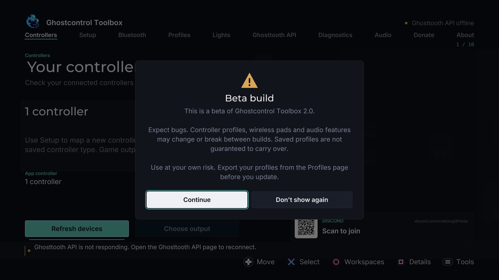
</p>

*Beta builds show a one-time launch notice; **Don’t show again** saves the preference.*

<p align="center">
  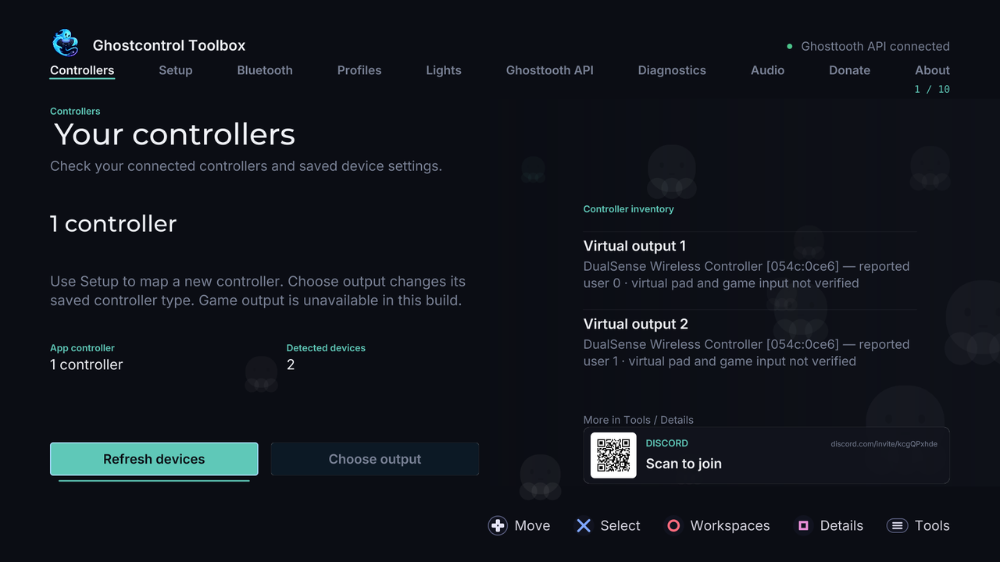
</p>

---

## Features

| Area | What you get |
|---|---|
| **Controllers & USB** | Third-party USB pads → virtual DualSense, XInput/DInput, per-device rules, slot assignment |
| **Profiles** | Create / edit / rename / import / export mapping profiles |
| **Guided setup** | Learn an unknown pad control-by-control with live capture |
| **Lights & rumble** | DualSense lightbar FX (solid, breathe, rainbow, strobe…) and motor test |
| **Bluetooth** | Classic + LE gamepads, pair / forget / retry |
| **Service** | Start / stop / restart companion, autostart, diagnostics, log tail |
| **GhostPad** | Optional network pad input for remote / ESP bridges |
| **About / Donate** | Credits, support links, Discord / BTC / Patreon QR codes |

Full source inventory: [`FEATURES.md`](FEATURES.md). User guides: [`docs/wiki/`](docs/wiki/).

<p align="center">
  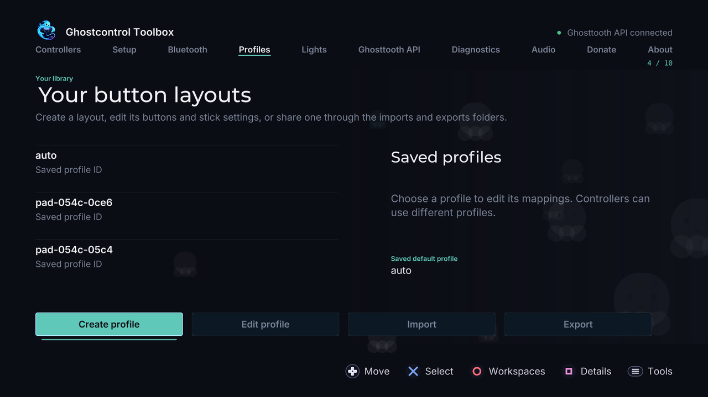
  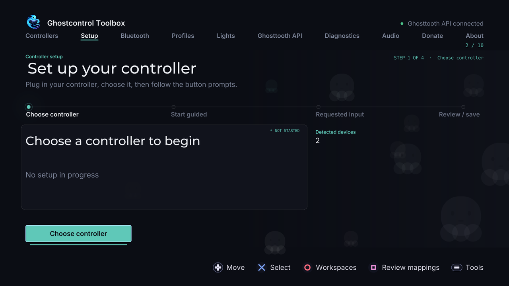
</p>
<p align="center">
  
  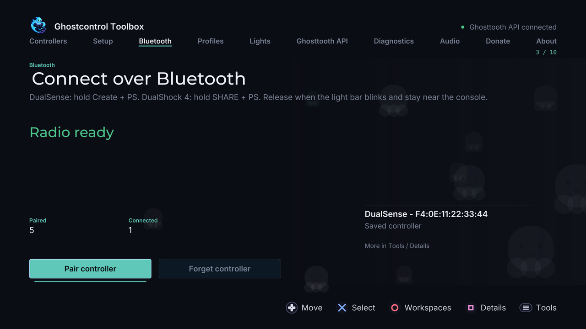
</p>
<p align="center">
  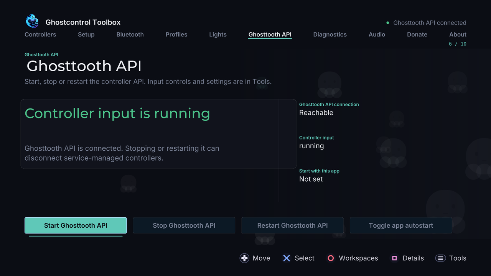
  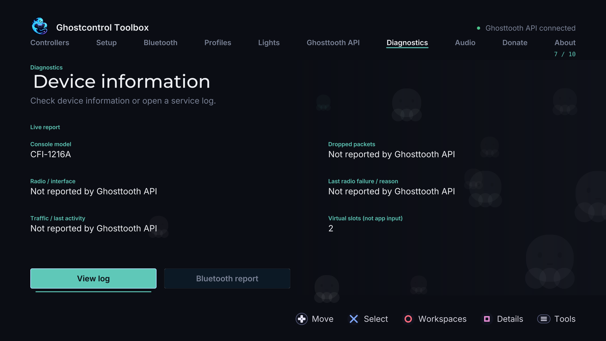
</p>
<p align="center">
  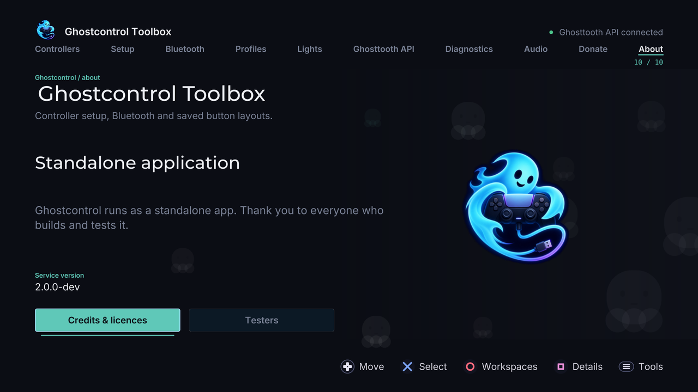
  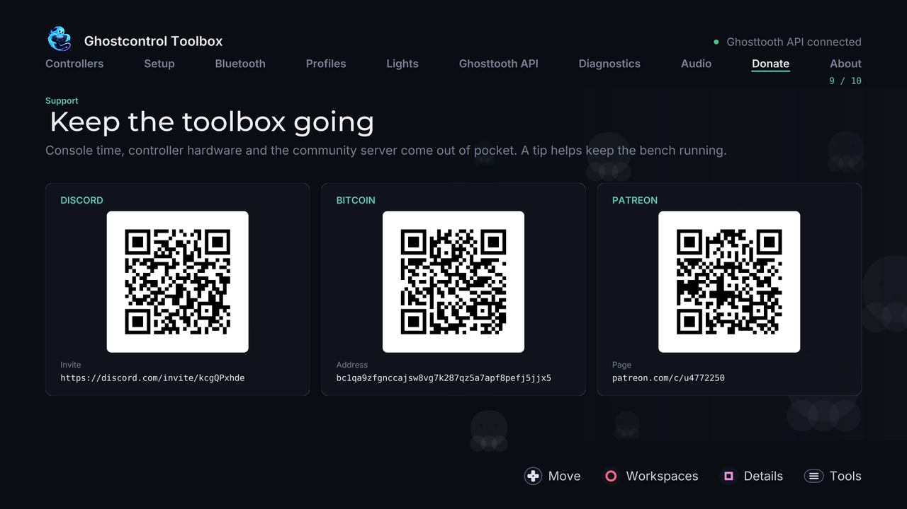
</p>

---

## How it works

```
USB / BT controller ──► GhosttoothAPI (resident service, ELF loader :9021)
                              │  GC1 IPC (local only)
                              ▼
                    Ghostcontrol Toolbox (native title under /data/homebrew)
```

1. Load **GhosttoothAPI.elf** on the ELF loader (port **9021**).
2. Install and open the **Ghostcontrol Toolbox** home-screen title.
3. Start the service from the **Service** page if it is not already running.
4. Plug in your controller, assign the virtual DualSense when the PS5 asks, and play.

The app never injects into ShellUI. It is a normal homebrew title with ordinary pad, user-service, and network APIs. IPC is local-only (loopback / console address).

---

## Requirements

- Jailbroken PS5 with an ELF loader (tested through current 13.x beta line)
- [ps5-payload-sdk](https://github.com/ps5-payload-dev/sdk)
- UI kit + native deps fetched by `tools/fetch-deps.sh` (pinned in `tools/deps.lock`)
- A DualSense (or another pad the Toolbox can drive) for the menus while you configure a custom controller

Supported USB matrix (1.x baseline, still useful): [`Supported_controllers.md`](Supported_controllers.md). Adding devices: [`othercontrollersGuide.md`](othercontrollersGuide.md).

---

## Build

```sh
export PS5_PAYLOAD_SDK=/path/to/ps5-payload-sdk

# Companion service (load this on :9021)
make -C GhosttoothAPI

# Native Toolbox title (packages the companion into the app assets)
make -C ui deps
make -C ui app \
  GHOSTTOOTH_ELF="$PWD/GhosttoothAPI/GhosttoothAPI.elf" \
  GHOSTTOOTH_NOTICES="docs/release-notices/ps5-homebrew-ui-NOTICES.md"
```

Outputs:

- `GhosttoothAPI/GhosttoothAPI.elf` — resident companion
- `ui` build root / dist title folder + ZIP (kit-generated under the configured `GC_BUILD_ROOT`)

Deploy helpers: `tools/deploy-app.py`, `tools/deploy-core.py`. Set `PS5_HOST` to your console.

---

## Repository layout

```
core/            Controller service sources (USB, BT, profiles, IPC, FX, …)
ui/              Native Toolbox app (screens, assets, sce_sys art)
GhosttoothAPI/   Companion ELF build (links core/src)
tools/           Fetch deps, compose kit, title id, deploy, XMB art
docs/wiki/       End-user guides
docs/            Architecture notes used by the product
media/           README brand art + console screenshots
FEATURES.md      Capability → source map
```

This tree is the **clean product source**. Development noise (host test suites, audit dumps, session progress logs, wire scripts) lives only in the private toolbox workspace and is not mirrored here.

---

## From 1.x

Earlier releases in this repository were the single-payload USB→VDI line (`ghost-control-ps5.elf` / `payload/`). That approach is superseded by the 2.0 native app + companion design:

- No ShellUI module injection
- No HomeUI / Settings bundle patching
- No per-firmware offset tables
- Home-screen title + local GC1 IPC instead of an XMB overlay

Historical research notes such as `ProControllerResearch.md` remain under `docs/` where still useful.

---

## Docs

| Doc | Topic |
|---|---|
| [Getting Started](docs/wiki/Getting-Started.md) | Install, launch, first controller |
| [Guided Controller Setup](docs/wiki/Guided-Controller-Setup.md) | Learn a new pad |
| [Profile Sharing](docs/wiki/Profile-Sharing-and-Import.md) | Import / export INI profiles |
| [DualSense Tools](docs/wiki/DualSense-Tools.md) | Lightbar, rumble, motion |
| [Toolbox Reference](docs/wiki/Toolbox-Reference.md) | Every page |
| [Troubleshooting](docs/wiki/Troubleshooting-and-Logs.md) | Logs and recovery |
| [GhostPad API](docs/GHOSTPAD-API.md) | Network pad protocol |

---

## Support

Tips keep the project moving — same destinations as the in-app Donate page:

- **Discord:** [https://discord.com/invite/kcgQPxhde](https://discord.com/invite/kcgQPxhde)
- **Bitcoin:** `bc1qa9zfgnccajsw8vg7k287qz5a7apf8pefj5jjx5`
- **Patreon:** [https://www.patreon.com/c/u4772250](https://www.patreon.com/c/u4772250)
- **QR codes:** `media/brand/qr/` (Discord, BTC, Patreon, Lightning)

---

## License

GPL-3.0-or-later for Ghostcontrol project sources unless a file says otherwise.

Third-party terms: fonts under `ui/assets/fonts/*-LICENSE.txt`, UI kit and SDK notices under `docs/release-notices/`. Preserve SPDX headers and dependency licenses; this README is not a relicense.
